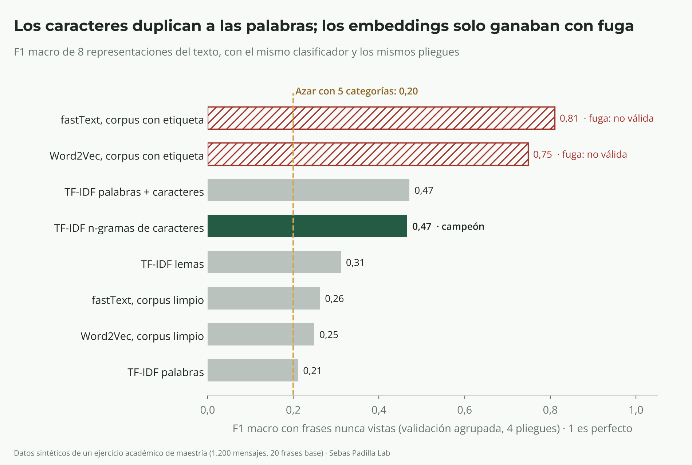
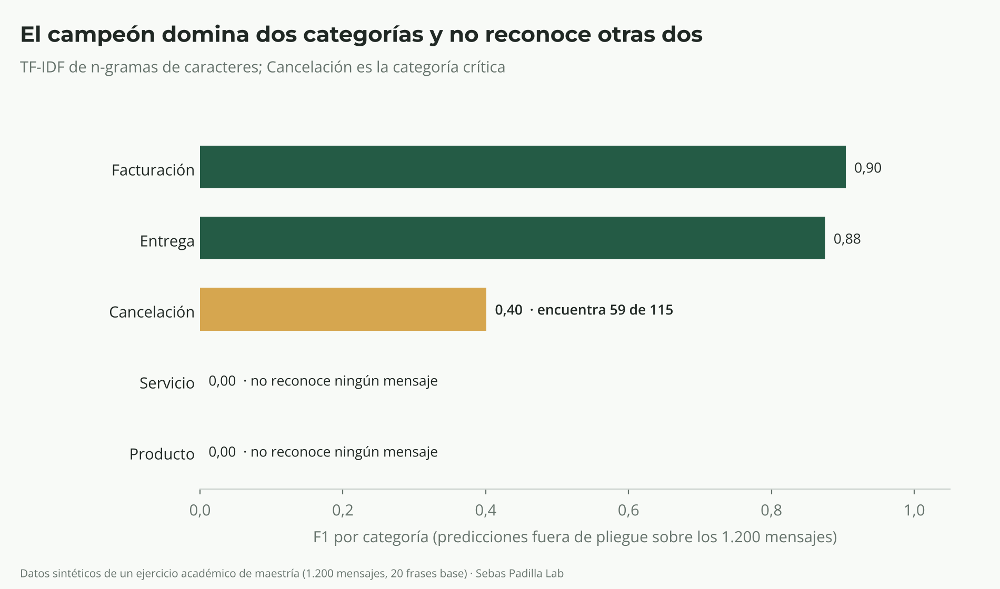
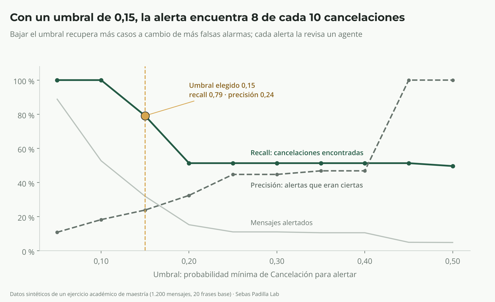

# ¿Qué mensajes anuncian una cancelación?

**Sebas Padilla Lab · Pilar Machine Learning · Ejercicio académico de la Maestría en Ciencia de Datos, 2026**

Caso en el sitio: https://sebaspadi97.github.io/es/proyectos/mensajes-de-cancelacion/ · Aplicación interactiva: https://sebaspadi97.github.io/interactivos/mensajes-de-cancelacion/

> **Pregunta:** ¿qué representación del texto permite clasificar los mensajes de los clientes en cinco categorías y detectar a tiempo los que anuncian una cancelación?

> **Ejercicio académico.** Los datos son sintéticos y la información es de carácter académico: no contiene datos personales, privados ni de ninguna empresa.

## English summary
**Which messages signal a cancellation?** A tournament of text representations (TF-IDF on words, lemmas and character n-grams; Word2Vec and fastText averages) to route 1,200 synthetic customer messages into five categories. The audit found that the 1,200 rows are only 20 base phrases with added noise, so a random split scored a meaningless F1 of 1.00. With group-aware validation (StratifiedGroupKFold by base phrase), character n-grams won with macro F1 0.47 versus 0.21 for words; embeddings only "won" (0.81) because the auxiliary corpus carried the label. The committee recommends an assisted pilot: a cancellation alert at probability ≥ 0.15 (recall 0.79) and auto-routing only at confidence ≥ 0.70. Academic team exercise with synthetic data. Python · scikit-learn · pandas · numpy.

## Equipo y rol
| Integrante | Rol | Aporte principal |
| --- | --- | --- |
| **Sebastián Padilla** | Ciencia de Datos | Auditoría de los datos, control de fuga, pruebas A/B y embeddings |
| Juan David Gonzalez | Especialista en Machine Learning | Pipelines, torneo de representaciones, métricas y umbrales |
| Nelsón Fabian Manios | Gerencia de IA | Criterios de aceptación, costo, riesgo y decisión del comité |

## Sobre los datos
- **Ejercicio académico con datos sintéticos.** Los 1.200 mensajes se crearon como material de práctica a partir de 20 frases base con ruido agregado: mayúsculas, emojis, signos repetidos, errores de escritura y enlaces y correos de clientes ficticios.
- Ningún mensaje corresponde a una persona, un cliente o una empresa real. No hay datos del empleador del autor.
- Las cifras son hallazgos del análisis, no impacto real.
- Los datos son material de práctica del ejercicio y **no se incluyen en este repositorio**. Para ejecutar el cuaderno se colocan en `datos/` (ver *Cómo ejecutarlo*).

## En 30 segundos
- **Datos:** 1.200 mensajes de 4 canales (chat, correo, web, WhatsApp) en 5 categorías. Cancelación es la más pequeña (9,6 %) y la más costosa de fallar.
- **La auditoría cambió todo:** las 1.200 filas son 219 textos distintos y solo 20 frases base. Con una partición al azar, el 91 % de los mensajes de prueba ya estaba en entrenamiento y cualquier modelo sacaba F1 = 1,00.
- **Validación agrupada:** con frases nunca vistas, TF-IDF de palabras cae a 0,21 (el azar es 0,20) y el campeón, TF-IDF de n-gramas de caracteres, llega a 0,47.
- **Tres fugas descartadas:** los duplicados, la prioridad (solo marca "alta" en Facturación y Cancelación) y un corpus de embeddings con la categoría pegada a cada frase (fastText 0,81 con fuga, 0,26 sin ella).
- **Por categoría:** Facturación 0,90 y Entrega 0,88; Cancelación 0,40; Producto y Servicio en 0.
- **Decisión:** piloto asistido. Alerta de Cancelación con probabilidad ≥ 0,15 (encuentra 8 de cada 10) y autoclasificación solo con confianza ≥ 0,70 (7 % de los mensajes).





## Método
1. **Auditoría con 10 pruebas A/B:** duplicados, datos personales, enlaces, emojis y signos, mayúsculas y tildes, errores de escritura, negación, desbalance, metadatos y corpus de embeddings.
2. **Frase base y validación agrupada:** `StratifiedGroupKFold` de 4 pliegues por frase base; ninguna frase está a la vez en entrenamiento y prueba.
3. **Torneo:** el mismo clasificador (regresión logística balanceada) sobre 8 representaciones; el vectorizador se ajusta dentro del `Pipeline` en cada pliegue.
4. **Regla de selección:** si dos representaciones válidas quedan a menos de 0,01 de F1, gana la de menos rasgos.
5. **Umbrales:** alerta de Cancelación (recall ≥ 0,75) y autoclasificación (exactitud ≥ 90 %) sobre probabilidades fuera de pliegue.

## Limitaciones
- **Pocos datos:** 20 frases base; el F1 del campeón varía entre 0,32 y 0,60 según el pliegue.
- **Servicio y Producto sin resolver:** sus frases no comparten vocabulario.
- **Umbrales sin calibrar** con mensajes reales.
- **Embeddings:** gensim no estaba disponible; se usó una implementación en numpy del mismo algoritmo (skip-gram con muestreo negativo).

## Contenido
| Carpeta o archivo | Contenido |
| --- | --- |
| `notebooks/torneo_representaciones.ipynb` | Cuaderno completo y ejecutado: auditoría, torneo, embeddings y comité |
| `tablas/` | Backlog de auditoría, resultados A/B, matriz comparativa, F1 por categoría, matriz de confusión y tablas de umbrales |
| `graficos/` | 3 gráficos con la identidad de SP Lab |
| `scripts/graficos.py` | Genera los gráficos desde `tablas/` |
| `sitio web/` | Ficha del caso para el sitio y aplicación interactiva (`sitio web/aplicacion/index.html`) |
| `fuentes/` | Tipografías de la marca (Montserrat y Open Sans, SIL Open Font License) |

## Cómo ejecutarlo
```bash
# Los datos del ejercicio no se publican: colocar interacciones_clientes.csv y corpus_embeddings.txt en datos/
pip install pandas numpy scikit-learn matplotlib
cd notebooks && jupyter lab torneo_representaciones.ipynb   # Restart & Run All
python scripts/graficos.py                                   # gráficos desde tablas/
```
gensim es opcional: si no está instalado, el cuaderno omite ese paso y usa la implementación de respaldo.

## Uso de inteligencia artificial
El análisis, el código y los materiales se prepararon con apoyo de Claude (Anthropic). Todas las cifras se verificaron con las ejecuciones del cuaderno.

## Licencia
- **Código** (`scripts/`, `notebooks/`): © 2026 Juan David Gonzalez, Nelsón Fabian Manios y Sebastián Padilla Castaño. Todos los derechos reservados.
- **Tablas, gráficos y aplicación:** todos los derechos reservados; se pueden citar con atribución al equipo.
- **Datos:** material de práctica del ejercicio académico; no se incluyen ni se redistribuyen.
- **Tipografías** (`fuentes/`): Montserrat y Open Sans, bajo SIL Open Font License 1.1.
- Ver `LICENSE.md`.

---
Parte de **Sebas Padilla Lab** · De los datos a las decisiones.
